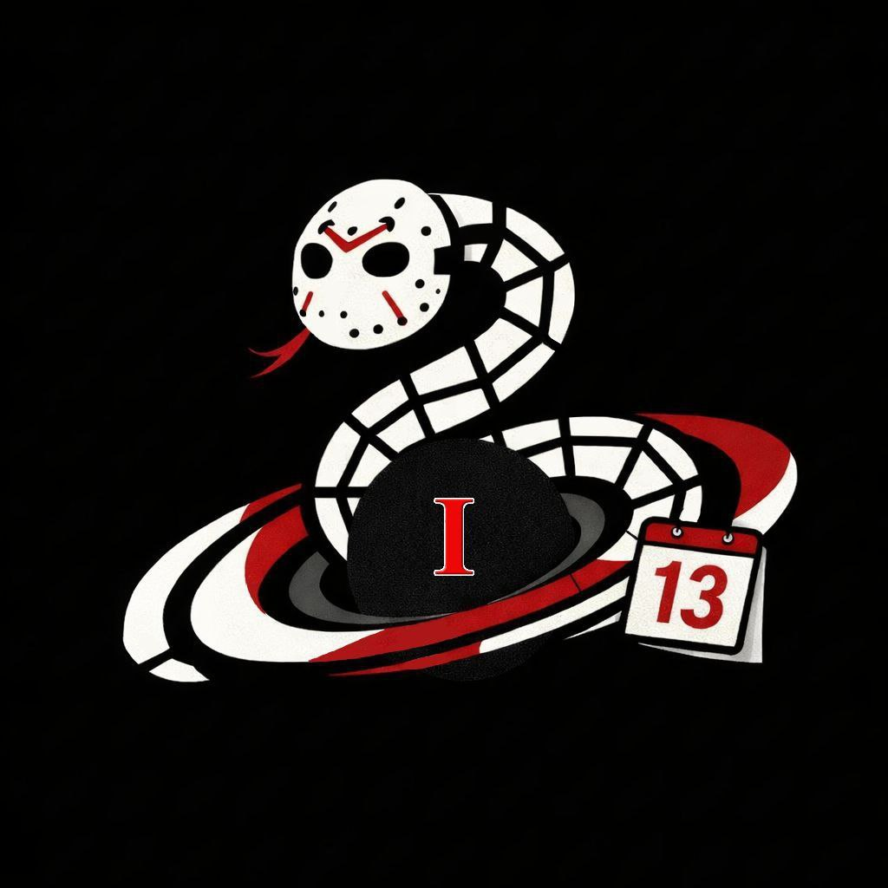
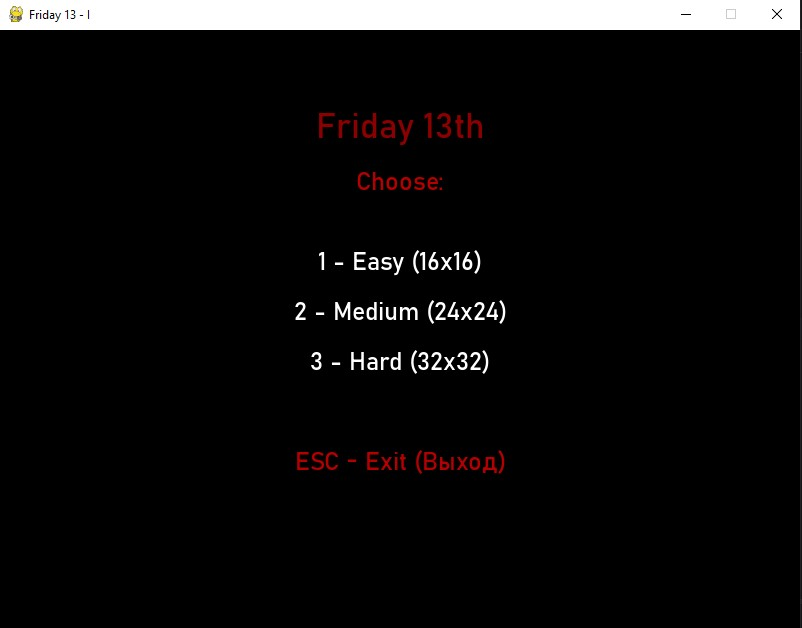
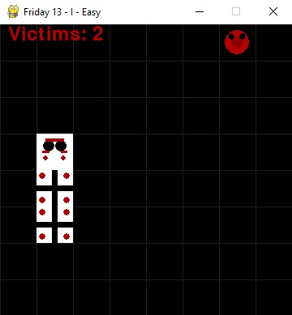
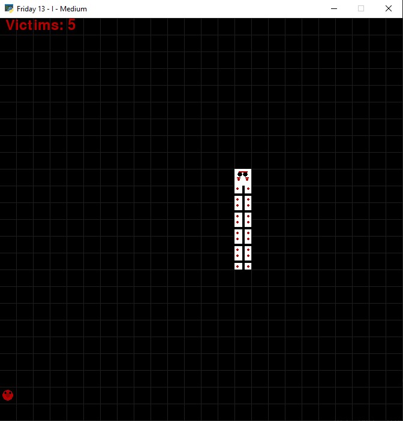
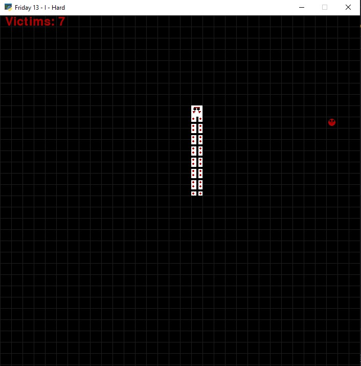
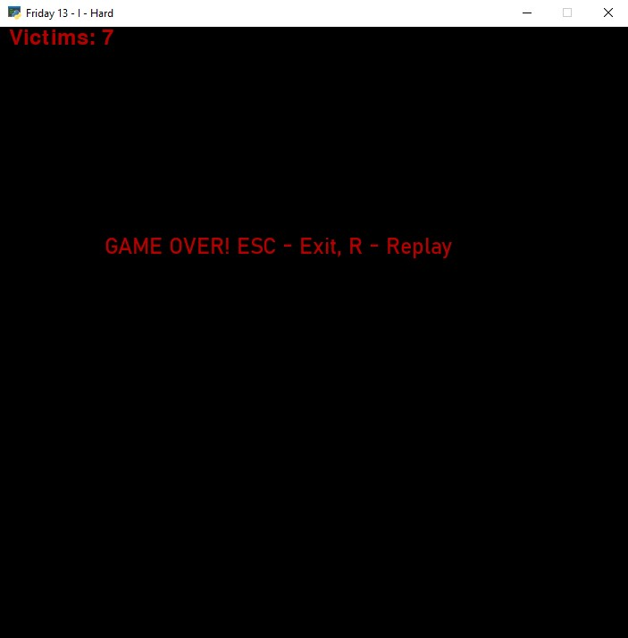

# Friday 13 - I

> Classic Snake with a horror atmosphere and three difficulty levels.

| Project Information | Details |
|---|---|
| Project ID | NS-002 |
| Direction | Games |
| Development Phase | Phase I |
| Version | v1.1 |
| Platform | Windows / Python |
| Status | Completed |

> 

## 📖 Overview

A horror-themed interpretation of classic Snake. The goal is to fill the board by collecting targets and avoiding collisions.

## ✨ Features

- Three board sizes: 8×8, 12×12 and 16×16
  
- Difficulty-based movement speed

- Score tracking and level completion records

- Persistent local records

## 🛠 Technology Stack

- Python
- Pygame
- JSON

## 📦 Installation

- Download EXE from Releases: [more...](https://github.com/NebulaStack-prog/Friday-13-I/releases/tag/v1.0)

- Or run with Python: [more...](Friday13-I-New.py)

- Original source code (Old): [more...](Friday13-I.py)

## 📄 Documentation

- Russian documentation: [more...](FrDay13-I_RU.md)

- English documentation: [more...](FrDay13-I_EN.md)

## 📊 Project Status

A completed NESTIMS Phase I project. Both the original and updated Python implementations are preserved.

## 📷 Screenshots

© NESTIMS
